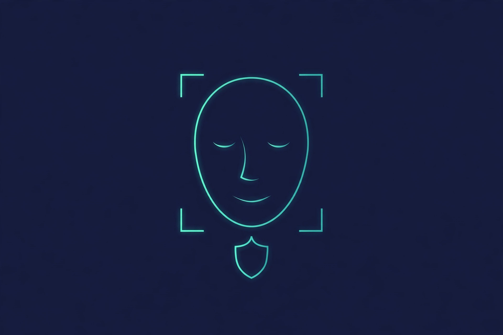

# FaceGuard

## AI access control and attendance, deployed on a live factory floor

FaceGuard is an enterprise access control and attendance system powered by real time face recognition. It was designed, built and deployed in one month at Swelect HHV Solar Photovoltaics, where it runs on live factory cameras to identify employees, control access and log attendance automatically. No badges, no queues, no manual registers, just walk up and the system knows who you are.

### How it works

- **Dual camera RTSP pipeline.** Two live camera streams are processed in parallel with multi threaded capture, so entry and exit are tracked at the same time without dropping frames.
- **State of the art face AI.** Detection runs on YuNet and recognition on SFace, both as ONNX models accelerated with CUDA through ONNX Runtime, delivering fast, accurate identification on a continuous video feed.
- **Real time operator dashboard.** A PyQt6 desktop application shows live recognition events, access decisions and attendance as they happen, built for security and admin teams to run day to day.
- **Enterprise data layer.** Recognition events and attendance records are written to Microsoft SQL Server through pyodbc, giving the factory a reliable, queryable system of record.

### Tech stack

Python, OpenCV, YuNet, SFace, ONNX Runtime with CUDA, RTSP, PyQt6, Microsoft SQL Server, pyodbc, multi threading.

### Why it matters

Manual attendance and badge based access are slow, error prone and easy to game. FaceGuard replaces them with a contactless system that verifies identity in real time and creates a trustworthy audit trail of every entry and exit, built and shipped end to end by one developer, from model pipeline to production deployment.

### Built by

Created and developed by Ashtav Arun during a Software Engineering Internship at Swelect HHV Solar Photovoltaics Private Limited, June to July 2026.
